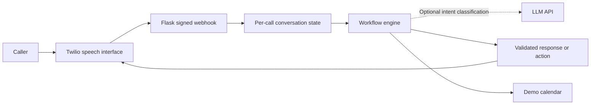

# AI Voice Agents

A collection of four experimental conversational workflows for telephone-based customer assistance. The project separates conversation state from telephony and optional language-model inference, allowing developers to try the core logic without API accounts or paid calls.

> Status: early-stage research prototype. The current version is a generic redevelopment of earlier voice-agent experiments. No adoption metrics or production readiness are claimed.

## Workflows

| Workflow | What it demonstrates | Documentation |
| --- | --- | --- |
| Call routing | Intent detection, explicit confirmation, configured department transfer | [Guide](agents/call-routing/README.md) |
| Appointment scheduling | Availability search, conflict checking, confirmation before reservation | [Guide](agents/appointment-scheduling/README.md) |
| Outreach demo | Consent-first scripted conversation with a fictional offering | [Guide](agents/outreach/README.md) |
| Satisfaction survey | Opt-in rating, resolution status, optional feedback | [Guide](agents/satisfaction-survey/README.md) |

## Quick start (offline)

Python 3.10+ is required. From the repository root:

```sh
python -m voice_agents.demo routing
python -m voice_agents.demo appointments
python -m voice_agents.demo outreach
python -m voice_agents.demo survey
python -m unittest discover -s tests -v
```

The offline demo uses deterministic conversation logic and an in-memory calendar. It neither makes calls nor sends data to an external service.

## Architecture



## Telephone integration (optional)

1. Create a virtual environment and install `requirements.txt`.
2. Configure environment variables using `.env.example` as a reference. Do not commit real values. The application reads the process environment, not the example file.
3. Select a `VOICE_WORKFLOW` and run `python -m voice_agents.webhook`.
4. Expose the local server through an HTTPS endpoint you control. Set `PUBLIC_BASE_URL` to its exact external origin; configure the Twilio voice webhook to POST to `/voice`. Requests with invalid signatures are rejected.
5. Use a number you control for an inbound test. For an outbound test, run `python scripts/place_demo_call.py` for a dry run. A real call requires both `--execute` and `--consent` and may incur charges.

To enable optional LLM-based intent classification, set `ENABLE_LLM=1`, `LLM_API_URL` (full chat-completions endpoint), `LLM_MODEL`, and `LLM_API_KEY`. Use a provider you trust and obtain any required consent before sending caller utterances to it. Only allow-listed intent labels are accepted; no model-generated code is executed.

## Google Calendar (optional)

Install `requirements-calendar.txt` in addition to the telephony requirements. Set `ENABLE_GOOGLE_CALENDAR=1`, `GOOGLE_CALENDAR_ID` to a dedicated test calendar, and `CALENDAR_TIMEZONE` to an IANA timezone. Configure Google Application Default Credentials locally with calendar access; never commit credential files. Share only the test calendar with the authorized identity. The adapter rechecks availability before creating an event, but cannot guarantee atomic reservations against other calendar clients. Disable it for offline demos.

## Project layout

- `voice_agents/`: workflow engine, optional LLM classifier, CLI and telephone adapter.
- `agents/`: individual workflow guides and fictional conversation examples.
- `scripts/`: consent-gated single test-call utility.
- `tests/`: offline regression tests.
- `docs/`: architecture, limitations and development roadmap.

## Limitations

The default calendar is in-memory. An optional Google Calendar adapter is provided but has not been tested against a live calendar. The scheduling demo expects explicit date/time input. The optional classifier only handles intent labels. Transfers require locally configured destinations. The survey does not store free-text feedback. The outreach demo does not perform transactions or campaign dialing. Session state is process-local, and the webhook has not been validated with live telephony in this release preparation. See [architecture and limitations](docs/architecture.md).

## Contributing and license

See [CONTRIBUTING.md](CONTRIBUTING.md) and [SECURITY.md](SECURITY.md).

This project is available under the [MIT License](LICENSE).
Contributions and feedback are welcome.
